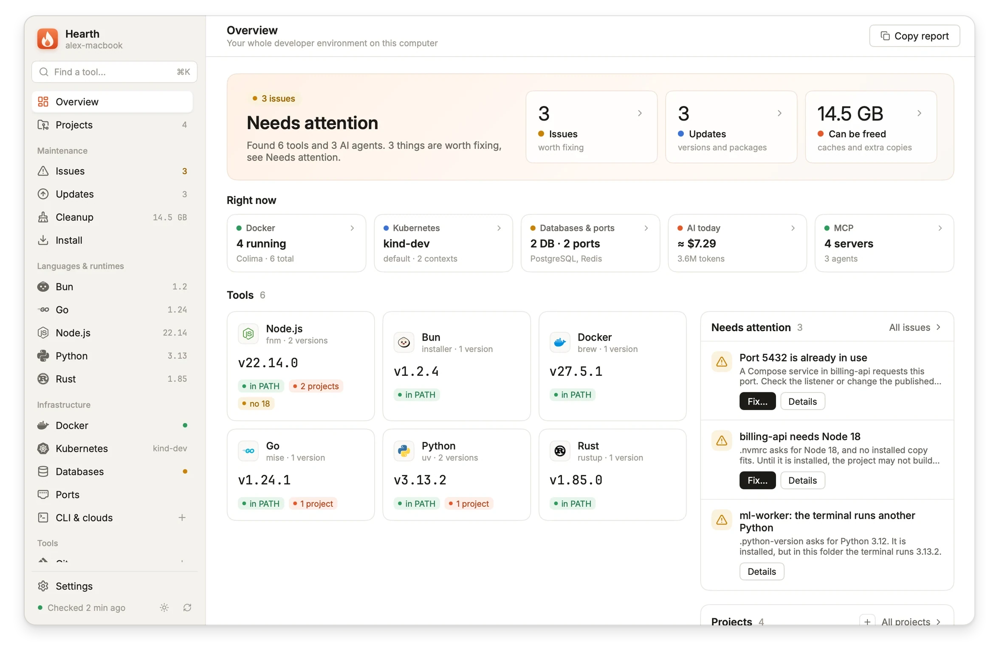
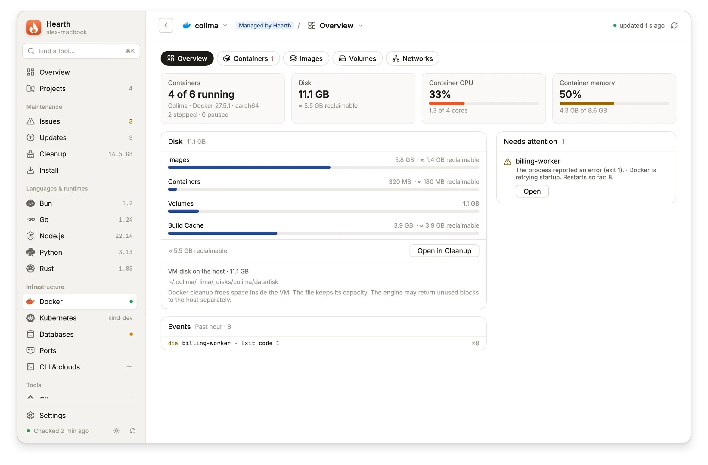
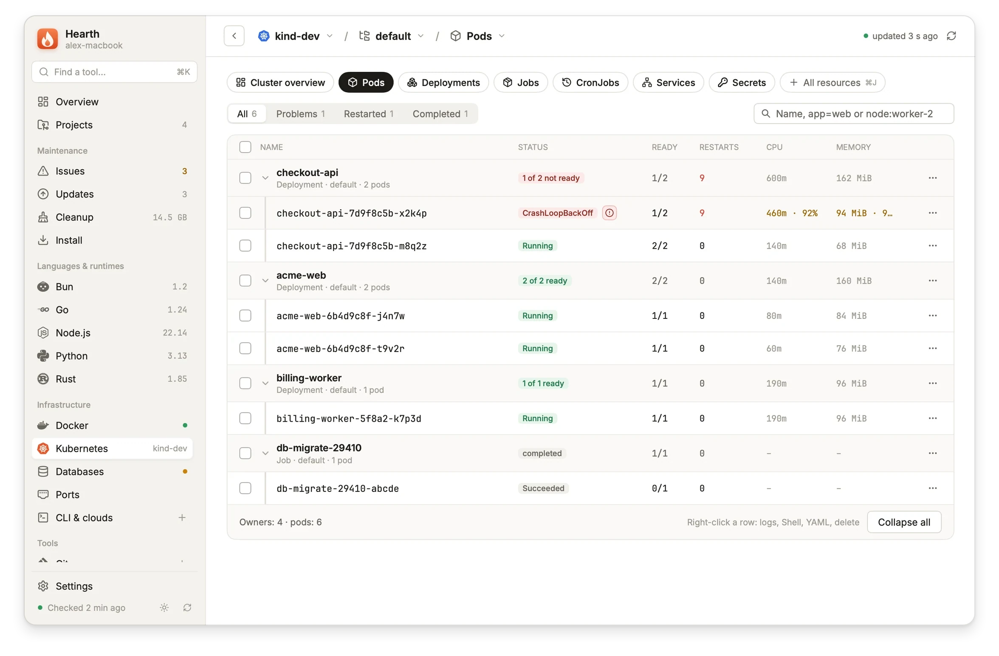
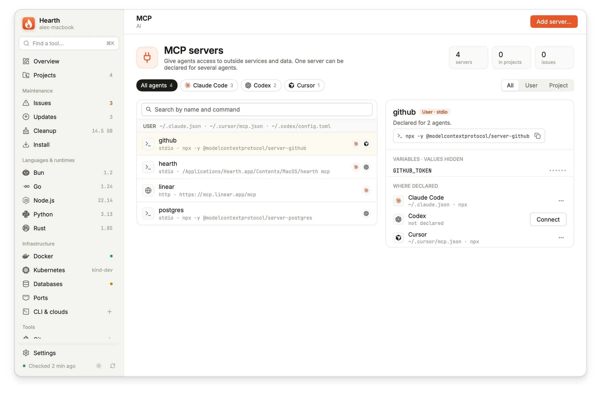
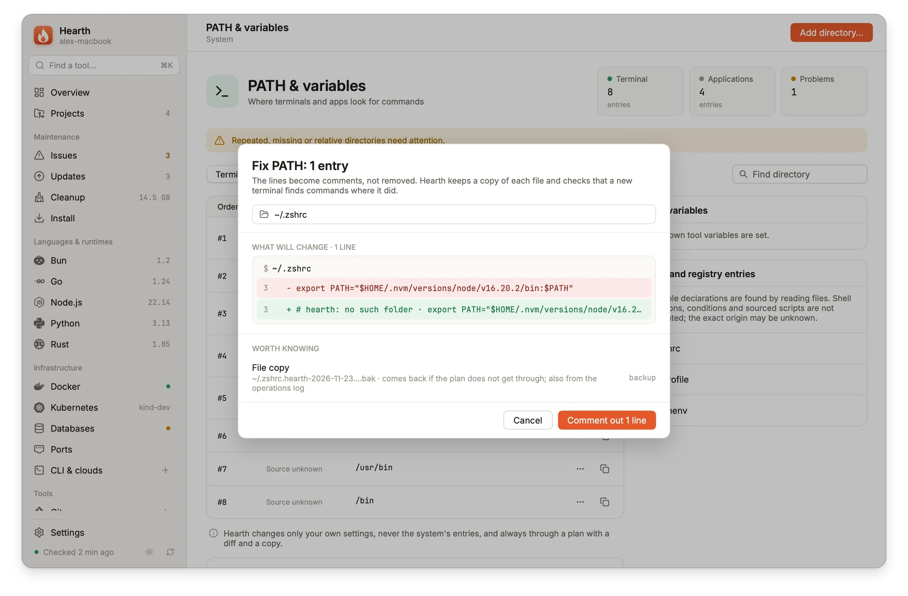

<p align="center">
  
</p>

<h1 align="center">Hearth</h1>

<p align="center">
  <strong>Free, open-source native Go alternative to Docker Desktop, Lens, Headlamp, and DBngin.</strong><br />
  Manage Docker/Colima, Kubernetes, local databases, runtimes, dev servers, and AI coding agents (MCP, skills, 18-provider quotas) in one ~70 MB RAM desktop app - no Electron, no WebView, zero telemetry.
</p>

<p align="center">
  <a href="https://github.com/Blinks44/hearth/actions/workflows/check.yml"></a>
  <a href="https://github.com/Blinks44/hearth/releases"></a>
  <a href="LICENSE"></a>
  
  <a href="https://hearth.moduix.dev"></a>
</p>

<p align="center">
  <a href="https://hearth.moduix.dev">Website</a> ·
  <a href="https://github.com/Blinks44/hearth/releases/latest">Download</a> ·
  <a href="#why-hearth">Comparison</a> ·
  <a href="#installation">Install</a> ·
  <a href="#hearth-as-an-mcp-server">MCP Server</a> ·
  <a href="docs/ROADMAP.md">Roadmap</a> ·
  <a href="SECURITY.md">Security</a>
</p>

```sh
# macOS (Homebrew) - Windows .exe and Linux .deb / .tar.gz / PKGBUILD in Releases
brew install --cask blinks44/tap/hearth
```

<p align="center">
  <picture>
    <source media="(prefers-color-scheme: dark)" srcset="docs/screenshots/overview-dark.webp" />
    <source media="(prefers-color-scheme: light)" srcset="docs/screenshots/overview-light.webp" />
    
  </picture>
</p>

---

## Why Hearth?

Most local dev setups end up juggling 4-5 separate Electron apps plus a tangle of shell scripts just to check containers, Kubernetes pods, local databases, `PATH` conflicts, and AI agent configs.

Hearth puts that daily workflow into a single native Go desktop app built with [mygo](https://mygo.egoist.dev). It does not reinvent container engines or version managers - it detects the CLIs you already use (`mise`, Colima, Docker, `kubectl`, `brew`, `winget`, `fnm`, `pyenv`, `uv`, `rustup`) and works through them.

| | Typical multi-app setup | Hearth |
| --- | --- | --- |
| **Stack** | Docker Desktop + Lens/Headlamp + DBngin + ad-hoc scripts | One native Go binary (`mygo`, zero Electron, zero WebView) |
| **Memory** | ~1.5-2.5 GB RAM across multiple Electron windows | ~70 MB idle / ~150 MB active |
| **Download / Disk** | 1+ GB across separate installers | ~13-19 MB download (~44-48 MB installed) |
| **Safety** | Silent edits or manual copy-paste into `~/.zshrc` | Read-only scans; every fix shows a plan, diff, and `.bak` backup first |
| **License & Privacy** | Mixed commercial tiers, accounts, telemetry | Free & MIT, 100% local, no account, zero telemetry |

---

## Screenshots

| Docker & Colima | Kubernetes |
| --- | --- |
| <picture><source media="(prefers-color-scheme: dark)" srcset="docs/screenshots/docker-dark.webp" /></picture> | <picture><source media="(prefers-color-scheme: dark)" srcset="docs/screenshots/kubernetes-dark.webp" /></picture> |

| AI & MCP | Safe Plan & Diff |
| --- | --- |
| <picture><source media="(prefers-color-scheme: dark)" srcset="docs/screenshots/ai-mcp-dark.webp" /></picture> | <picture><source media="(prefers-color-scheme: dark)" srcset="docs/screenshots/plan-diff-dark.webp" /></picture> |

---

## What Hearth Does

### 1. Docker, Kubernetes, Local Databases & Ports
- **Docker:** Manage local engines (first-class open-source **Colima** setup and VM resource controls on macOS, native Docker Engine on Linux), Compose-grouped containers, streaming logs, interactive terminal shell, images, volumes, networks, and disk cleanup.
- **Kubernetes:** Browse merged `KUBECONFIG` contexts without background cluster polling, create local `kind` clusters, inspect Pods/Deployments/Jobs/Services/PVCs/Nodes/Helm/CRDs, stream pod or owner logs, manage `127.0.0.1` port-forwards, and apply manifests with server-side dry-run.
- **Databases & Ports:** Inspect local PostgreSQL, MySQL/MariaDB, Redis, MongoDB, SQL Server, and SQLite services alongside Docker containers, catch Compose port conflicts before startup, and inspect listening TCP ports with CPU/RAM usage and framework detection.

### 2. AI Coding Agents: Quotas, MCP, Skills & Agent Radar
- **AI Quotas & Limits:** Read-only subscription and rate-limit tracking across 18 providers (Claude Code, Codex, Cursor, GitHub Copilot, Gemini CLI, Windsurf, JetBrains AI, Antigravity, Grok, Cline, Kimi, OpenCode Go, Kiro, Kilo, Amp, Augment, CodeRabbit, HuggingFace) with burn-pace markers, reset times, and optional low-quota desktop notifications.
- **Unified MCP & Secret Checks:** View MCP servers across Claude Code, Codex, Cursor, Copilot CLI, Gemini CLI, OpenCode, and more; catch config conflicts and plaintext tokens with one-click "Move to env var" migration.
- **Skills, Instructions & Local Models:** Canonical `~/.agents/skills` storage with symlinks, public and private Git skill catalogs, global `~/.agents/AGENTS.md` sync, local **Ollama / LM Studio** models, and local session token/cost analytics.
- **AI Agent Radar:** Live passive detection of running coding agents plus opt-in lifecycle hooks (`hearth notify`) that alert you when an agent finishes or waits for input.

### 3. Runtimes, PATH, Projects & Managed Dev Servers
- **Three-way runtime clarity:** See what is **installed on disk**, what a **new terminal resolves on `PATH`** (`which -a` + GUI vs terminal `PATH` drift), and what **each project expects** (`.nvmrc`, `mise.toml`, `.tool-versions`, `pyproject.toml`, `go.mod`, `rust-toolchain.toml`, `global.json`, `composer.json`, `*.tf`, Compose, and K8s manifests).
- **Managed Script Runner:** Start and stop scripts from `package.json`, `Makefile`, `Taskfile.yml`, `justfile`, `mise.toml`, and `composer.json` directly inside Hearth with streaming logs and clean process-group teardown.
- **Project Prep, Git & Shell Startup:** Clone repos, inspect Git SSH/credential setup, prepare a project with a single confirmed plan, and profile slow `zsh`/`bash`/`fish`/PowerShell startup lines (`nvm`, `pyenv`, `conda`, `compinit`).

### 4. Live Menu Bar / System Tray, Cleanup & Machine Setup
- **Live Tray Control Center:** Native menu bar / system tray popover showing running dev servers, Docker containers, local databases, Kubernetes port-forwards, compact AI quotas, Colima toggle, and 1-click Docker/K8s context switching.
- **Cleanup & Updates:** Reclaim gigabytes across unused language versions, package/build caches, Docker disk usage, old editor extensions, Xcode simulators / Android AVDs, stale AI history, and unused local models; track updates across Homebrew, WinGet, Scoop, Chocolatey, APT, DNF, Pacman, Zypper, APK, Snap, Flatpak, and Nix.
- **New Machine Setup:** Guided setup catalog (defaulting to `mise` and Colima/Docker Engine) with exportable/importable setup bundles.

---

## Hearth as an MCP Server

Hearth ships a built-in headless stdio MCP server (`hearth mcp`) so your AI coding agents can inspect your local machine safely without reading secrets or running arbitrary commands.

**Connect in one click:** Open **AI -> MCP** inside Hearth, select `hearth`, and click **Connect** next to any installed agent.

Or configure any MCP client manually:

```json
{
  "mcpServers": {
    "hearth": {
      "command": "/Applications/Hearth.app/Contents/MacOS/Hearth",
      "args": ["mcp"]
    }
  }
}
```

- **Read-only tools:** `get_tools`, `get_projects`, `get_issues`, `get_agents`, `get_docker`, `get_ports_and_databases`, `get_skills`, `get_kubernetes`, `get_cleanup`, `get_usage`, `get_models`, `get_instructions`, `get_ai_quotas` (reads the cached snapshot by default; pass `refresh: true` for a fresh scan). Env var values, MCP commands/args/URLs, instruction/hook bodies, and raw detector errors are strictly excluded.
- **Read-only resources:** `hearth://summary`, `hearth://projects`, `hearth://issues`, `hearth://ports`.
- **Human-in-the-loop proposals:** `propose_fix`, `propose_project_prepare`, `propose_stop_process`, `propose_service_action`, `propose_skill_action`, `propose_tool_install`, and `propose_cleanup` ask the open Hearth window to prepare a standard plan with diff preview; no MCP tool can confirm or execute a change.

---

## Installation

Prebuilt binaries are available for **macOS (Apple Silicon & Intel)**, **Windows (x64 & ARM64)**, and **Linux (x64 & ARM64)** on the [Releases page](https://github.com/Blinks44/hearth/releases/latest). All releases include `SHA256SUMS.txt` and signed auto-updates.

### macOS

Install via Homebrew:

```sh
brew install --cask blinks44/tap/hearth
```

Or download `hearth-<version>-arm64.dmg` (Apple Silicon) or `hearth-<version>-amd64.dmg` (Intel) from [Releases](https://github.com/Blinks44/hearth/releases/latest) and drag Hearth to **Applications**.

> **First-launch note:** Hearth is free open-source software and currently ad-hoc signed (not yet notarized with a paid Apple Developer ID). Installing via Homebrew clears the macOS quarantine attribute automatically. If you install manually from the `.dmg` and macOS Gatekeeper warns about an unverified developer, open **System Settings -> Privacy & Security**, scroll to the Hearth notice, and click **Open Anyway** (or run `xattr -dr com.apple.quarantine /Applications/Hearth.app`).

### Windows

Download `hearth-setup-<version>-amd64.exe` (or `arm64.exe`) from [Releases](https://github.com/Blinks44/hearth/releases/latest) and run the installer (installs per-user to `%LOCALAPPDATA%\Programs\Hearth`, no UAC required).

> **First-launch note:** Because releases do not yet carry a paid Authenticode certificate, Windows SmartScreen may show "Windows protected your PC". Click **More info -> Run anyway**.

### Linux

- **Debian / Ubuntu (`.deb`):**
  ```sh
  sudo apt install ./hearth_<version>_amd64.deb   # or arm64
  ```
- **Any distro (user install without `sudo`, supports auto-updates):**
  ```sh
  sh install.sh hearth-<version>-linux-amd64.tar.gz
  ```
- **Arch Linux (`PKGBUILD`):** Download `PKGBUILD` from the release assets and run `makepkg -si`.

Runtime requirement on Linux: **GTK 3** only (no WebKitGTK needed).

---

## Building from Source

### Prerequisites

- **Go 1.27.3+** (`mygo` CLI and `golangci-lint` are managed automatically as Go tools).
- macOS, Windows 10+, or Linux with a desktop session. No cgo or C compiler required for normal builds (only `go test -race` requires gcc on Windows).

### Commands

```sh
git clone https://github.com/Blinks44/hearth.git
cd hearth
go mod download
go -C tools mod download

make dev      # run with live reload (or: go tool mygo dev)
make check    # format check, golangci-lint, mygo vet, i18n check, race + UI tests
make build    # build native bundle for the current OS into build/
make e2e      # end-to-end test driving the built app (requires desktop session)
```

On Windows without `make`, run the equivalent `go tool` commands directly (in PowerShell, quote `"-modfile=tools/go.mod"`):

```powershell
go tool mygo dev
go tool "-modfile=tools/go.mod" golangci-lint run
go tool mygo vet .
go tool mygo i18n check
go test ./...
```

See [CONTRIBUTING.md](CONTRIBUTING.md) and [docs/architecture.md](docs/architecture.md) for codebase guidelines and UI localization (`en`, `de`, `es`, `fr`, `ru`, `zh-Hans`).

---

## License

Hearth is released under the [MIT License](LICENSE).

Third-party fonts, icons, and Go modules bundled in releases keep their respective licenses; see [resources/NOTICE.txt](resources/NOTICE.txt) (also viewable in the app under **Settings -> About -> Licenses**).

## Acknowledgements

Hearth builds on great open-source tools and libraries:

- [mygo](https://mygo.egoist.dev): native cross-platform Go UI framework
- [Go](https://go.dev) and the Go ecosystem (`modelcontextprotocol/go-sdk`, `k8s.io/client-go`, `BurntSushi/toml`, `Masterminds/semver`, `go.yaml.in/yaml`, `modernc.org/sqlite`)
- [Colima](https://github.com/abiosoft/colima) and [mise](https://mise.jdx.dev): open-source foundations for local containers and version management
- [Inter](https://rsms.me/inter/) and [JetBrains Mono](https://www.jetbrains.com/lp/mono/): embedded UI and monospace typefaces (SIL OFL 1.1)
- [Lucide](https://lucide.dev), [Simple Icons](https://simpleicons.org), and [theSVG](https://thesvg.org): UI icons and tool logos

---

## Also by Sergey V.

- [**Monny**](https://monny.moduix.dev): Native macOS menu bar system monitor, battery charge limit, port finder, and AI quota tracker.
- [**Rebind**](https://rebind.moduix.dev): Native macOS input remapper for keyboards, multi-button and Logitech HID++ mice, smooth scrolling, and trackpad gestures.
