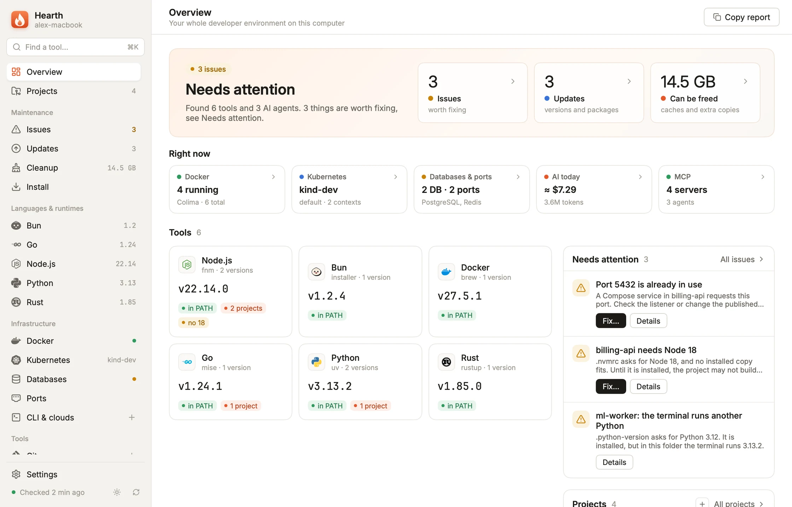
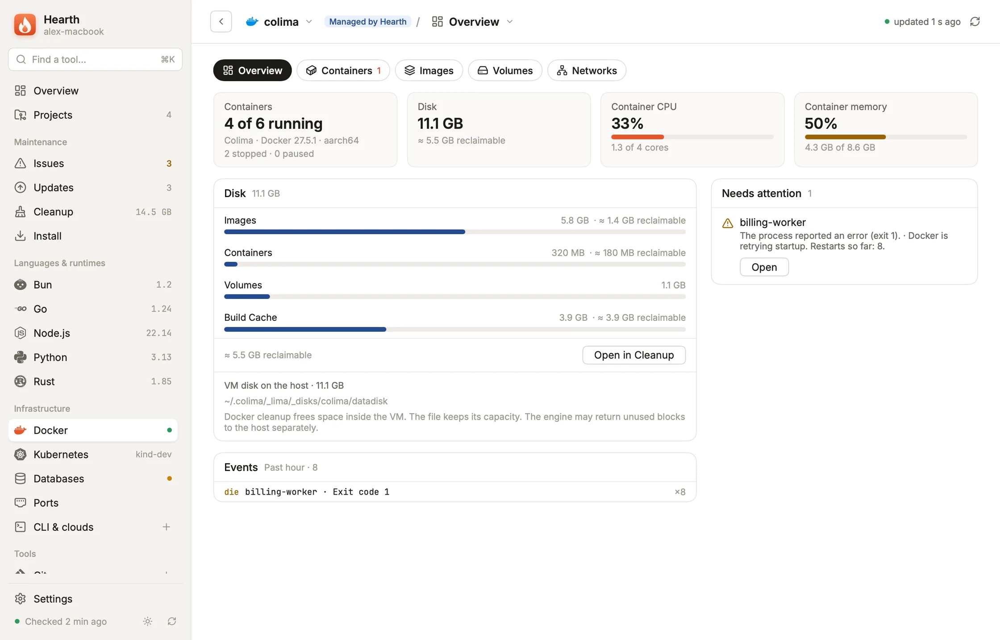
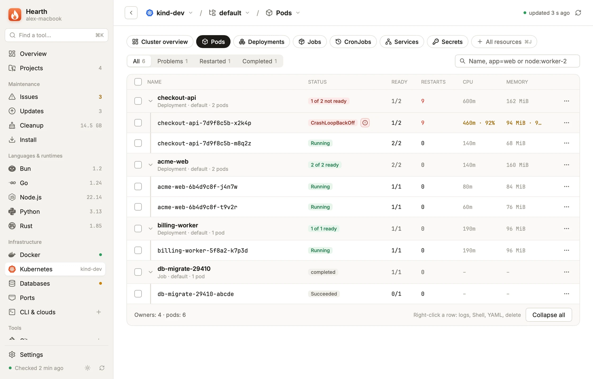
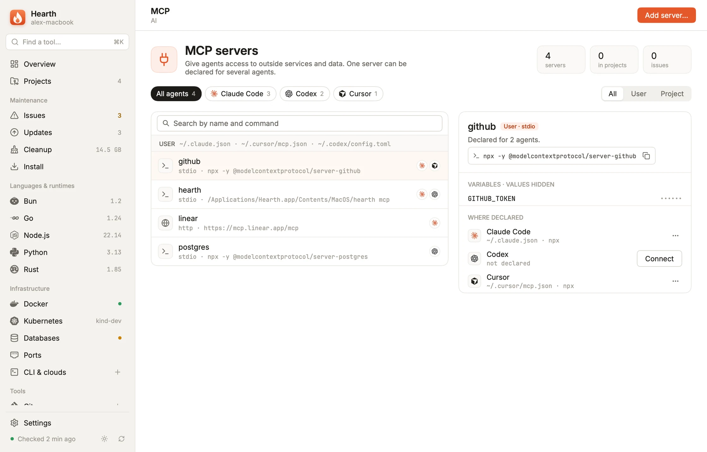
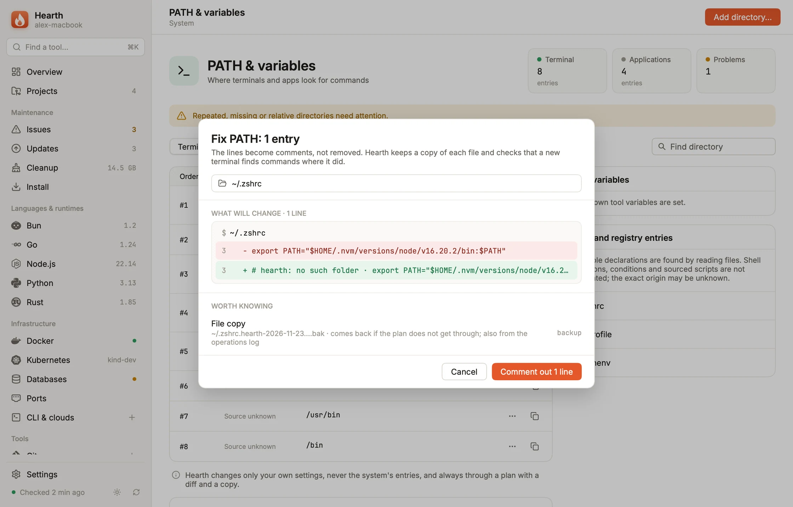

<p align="center">
  
</p>

<h1 align="center">Hearth</h1>

<p align="center">
  <strong>One calm home for your local dev environment.</strong><br />
  Inspect runtimes, projects, Docker, Kubernetes, local databases, AI agents, MCP servers, and disk usage, and fix anything with a clear plan and diff before a single file changes.
</p>

<p align="center">
  <a href="https://github.com/Blinks44/hearth/actions/workflows/check.yml"></a>
  <a href="https://github.com/Blinks44/hearth/releases"></a>
  <a href="LICENSE"></a>
  <a href="https://hearth.moduix.dev"></a>
</p>

<p align="center">
  <a href="https://hearth.moduix.dev">Website</a> ·
  <a href="https://github.com/Blinks44/hearth/releases/latest">Download</a> ·
  <a href="#installation">Install</a> ·
  <a href="#hearth-as-an-mcp-server">MCP Server</a> ·
  <a href="docs/ROADMAP.md">Roadmap</a> ·
  <a href="SECURITY.md">Security</a>
</p>

<p align="center">
  <picture>
    <source media="(prefers-color-scheme: dark)" srcset="website/public/screenshots/overview-dark.webp" />
    <source media="(prefers-color-scheme: light)" srcset="website/public/screenshots/overview-light.webp" />
    
  </picture>
</p>

---

## Why Hearth?

Modern local setups sprawl across `mise`, `fnm`, `nvm`, `uv`, `pyenv`, `rustup`, Homebrew, WinGet, Docker engines, `kubeconfig` contexts, local database services, and half a dozen AI coding agents. When something breaks (a project picks up the wrong Node version, port `5432` is already taken, your shell takes 2 seconds to open, or an MCP server leaks a plaintext token), finding *why* means piecing together a dozen CLI commands.

Hearth brings all of it into one native desktop app:

- **Native & lightweight:** ~18 MB single binary built in Go with [mygo](https://mygo.egoist.dev): no Electron, no WebView, and no background daemon hogging RAM.
- **Read-only by default:** Scanning never changes your machine. Every install, upgrade, fix, or cleanup shows the exact commands, file diffs, and consequences before you confirm.
- **Respects your existing setup:** Detects your current managers (`mise`, `fnm`, `nvm`, `volta`, `uv`, `pyenv`, `rbenv`, `rustup`, `brew`, `winget`, `scoop`, `apt`, `dnf`, `pacman`, etc.) and works through them. Shell rc edits stay inside `# >>> hearth >>>` markers with automatic backups.
- **100% local, zero telemetry:** No account, no analytics, no data uploaded anywhere.

---

## What Hearth Does

### 1. Runtimes, PATH & Projects
See the three facts that actually matter for every tool: what is **installed on disk**, what a **new terminal resolves on `PATH`** (`which -a` order + GUI `PATH` differences), and what **each project expects** (`.nvmrc`, `mise.toml`, `.tool-versions`, `pyproject.toml`, `go.mod`, `rust-toolchain.toml`, `global.json`, `composer.json`, `*.tf`, Compose, and K8s manifests). Prepare a fresh or existing project with a single confirmed plan.

### 2. Docker, Kubernetes, Local Databases & Ports
- **Docker:** Manage local engines (with first-class open-source **Colima** setup and VM resource controls on macOS, and native Docker Engine on Linux), containers grouped by Compose project, streaming logs, terminal shell, images, volumes, and networks.
- **Kubernetes:** Browse merged `KUBECONFIG` contexts without background cluster calls, spin up local `kind` clusters, inspect Pods/Deployments/Jobs/Services/PVCs/Nodes/Helm/CRDs, stream pod or owner logs, port-forward on `127.0.0.1`, and apply manifests with server-side dry-run.
- **Databases & Ports:** Inspect local PostgreSQL, MySQL/MariaDB, Redis, MongoDB, SQL Server, and SQLite services alongside Docker containers, detect Compose port conflicts, install/start/stop OS services, and inspect listening TCP ports.

### 3. AI Coding Agents, Skills, MCP & Usage
Manage **Claude Code**, **Codex**, **Cursor**, **GitHub Copilot CLI**, **Gemini CLI**, **OpenCode**, **Antigravity CLI**, **Devin**, **Grok Build**, and **Kimi Code** in one view:
- Shared `~/.agents/skills` canonical storage with agent symlinks, duplicate detection, and public skills catalog (Anthropic, OpenAI, Vercel, `skills.sh`).
- Unified MCP server list across agents with conflict detection, plaintext secret warnings, and one-click "Move to env var" migration.
- Global `~/.agents/AGENTS.md` sync, local **Ollama / LM Studio** models, and local session token/cost analytics read directly from agent history files.

### 4. Cleanup, Updates & Shell Startup
- **Cleanup:** Reclaim gigabytes across unused language versions, package/build caches, Docker disk usage, old editor extensions, Xcode simulators / Android AVDs, stale AI history (>90 days), and unused local models.
- **Updates & Package Managers:** Unified updates for runtimes and OS package managers (Homebrew, WinGet, Scoop, Chocolatey, APT, DNF, Pacman, Zypper, APK, Snap, Flatpak, Nix).
- **Shell Startup Profiler:** Measure `zsh`, `bash`, `fish`, and PowerShell startup time, pinpoint slow rc lines (`nvm`, `pyenv`, `conda`, `compinit`), and migrate `nvm` to `mise` safely.

### 5. New Computer Setup & Native Menu Bar / Tray
Set up a fresh machine with a guided catalog (defaulting to `mise` for languages and Colima/Docker Engine for containers), export/import your setup bundle across machines, and toggle containers, Colima, or Docker/Kubernetes contexts right from the native menu bar / system tray.

<details>
<summary>More screenshots (Docker, Kubernetes, AI &amp; MCP, Safe Plan Diff)</summary>
<br />

| Docker | Kubernetes |
| --- | --- |
| <picture><source media="(prefers-color-scheme: dark)" srcset="website/public/screenshots/docker-dark.webp" /></picture> | <picture><source media="(prefers-color-scheme: dark)" srcset="website/public/screenshots/kubernetes-dark.webp" /></picture> |

| AI &amp; MCP | Safe Plan &amp; Diff |
| --- | --- |
| <picture><source media="(prefers-color-scheme: dark)" srcset="website/public/screenshots/ai-mcp-dark.webp" /></picture> | <picture><source media="(prefers-color-scheme: dark)" srcset="website/public/screenshots/plan-diff-dark.webp" /></picture> |

</details>

---

## Hearth as an MCP Server

Hearth includes a built-in headless stdio MCP server (`hearth mcp`) so your AI coding agents can inspect your local environment safely without reading secrets or running arbitrary commands.

**Connect in one click:** Open **AI -> MCP** inside Hearth, select `hearth`, and click **Connect** next to any installed agent.

Or configure any MCP client manually:

```json
{
  "mcpServers": {
    "hearth": {
      "command": "/Applications/Hearth.app/Contents/MacOS/Hearth",
      "args": ["mcp"]
    }
  }
}
```

- **Read-only tools:** `get_tools`, `get_projects`, `get_issues`, `get_agents` (reads the cached snapshot by default; pass `refresh: true` for a fresh scan). Environment variable values, MCP commands/args/URLs, instruction/hook bodies, and raw detector errors are strictly excluded.
- **Human-in-the-loop fixes:** `propose_fix(issue_id)` asks the open Hearth window to prepare the standard fix plan for an issue returned by `get_issues`. Hearth shows the full plan, diff, and a "Requested by AI agent" badge; nothing runs until you click confirm.

---

## Installation

Prebuilt binaries are available for **macOS (Universal: Apple Silicon & Intel)**, **Windows (x64 & ARM64)**, and **Linux (x64 & ARM64)** on the [Releases page](https://github.com/Blinks44/hearth/releases/latest). All releases include `SHA256SUMS.txt` and signed auto-updates.

### macOS

Install via Homebrew:

```sh
brew install --cask blinks44/tap/hearth
```

Or download `hearth-<version>.dmg` from [Releases](https://github.com/Blinks44/hearth/releases/latest) and drag Hearth to **Applications**.

> **First-launch note:** Hearth is free open-source software and currently ad-hoc signed (not yet notarized with a paid Apple Developer ID). On first launch, macOS Gatekeeper may warn about an unverified developer: open **System Settings -> Privacy & Security**, scroll to the Hearth notice, and click **Open Anyway**.

### Windows

Download `hearth-setup-<version>-amd64.exe` (or `arm64.exe`) from [Releases](https://github.com/Blinks44/hearth/releases/latest) and run the installer (installs per-user to `%LOCALAPPDATA%\Programs\Hearth`, no UAC required).

> **First-launch note:** Because releases do not yet carry a paid Authenticode certificate, Windows SmartScreen may show "Windows protected your PC". Click **More info -> Run anyway**.

### Linux

- **Debian / Ubuntu (`.deb`):**
  ```sh
  sudo apt install ./hearth_<version>_amd64.deb   # or arm64
  ```
- **Any distro (user install without `sudo`, supports auto-updates):**
  ```sh
  sh install.sh hearth-<version>-linux-amd64.tar.gz
  ```
- **Arch Linux (`PKGBUILD`):** Download `PKGBUILD` from the release assets and run `makepkg -si`.

Runtime requirement on Linux: **GTK 3** only (no WebKitGTK needed).

---

## Building from Source

### Prerequisites

- **Go 1.27.3+** (`mygo` CLI and `golangci-lint` are managed automatically as Go tools).
- macOS, Windows 10+, or Linux with a desktop session. No cgo or C compiler required for normal builds (only `go test -race` requires gcc on Windows).

### Commands

```sh
git clone https://github.com/Blinks44/hearth.git
cd hearth
go mod download
go -C tools mod download

make dev      # run with live reload (or: go tool mygo dev)
make check    # format check, golangci-lint, mygo vet, i18n check, race + UI tests
make build    # build native bundle for the current OS into build/
make e2e      # end-to-end test driving the built app (requires desktop session)
```

On Windows without `make`, run the equivalent `go tool` commands directly (in PowerShell, quote `"-modfile=tools/go.mod"`):

```powershell
go tool mygo dev
go tool "-modfile=tools/go.mod" golangci-lint run
go tool mygo vet .
go tool mygo i18n check
go test ./...
```

See [CONTRIBUTING.md](CONTRIBUTING.md) and [docs/architecture.md](docs/architecture.md) for codebase guidelines and UI localization (`en`, `de`, `es`, `fr`, `ru`, `zh-Hans`).

---

## License

Hearth is released under the [MIT License](LICENSE).

Third-party fonts, icons, and Go modules bundled in releases keep their respective licenses; see [resources/NOTICE.txt](resources/NOTICE.txt) (also viewable in the app under **Settings -> About -> Licenses**).

## Acknowledgements

Hearth builds on great open-source tools and libraries:

- [mygo](https://mygo.egoist.dev): native cross-platform Go UI framework
- [Go](https://go.dev) and the Go ecosystem (`modelcontextprotocol/go-sdk`, `k8s.io/client-go`, `BurntSushi/toml`, `Masterminds/semver`, `go.yaml.in/yaml`, `modernc.org/sqlite`)
- [Colima](https://github.com/abiosoft/colima) and [mise](https://mise.jdx.dev): open-source foundations for local containers and version management
- [Inter](https://rsms.me/inter/) and [JetBrains Mono](https://www.jetbrains.com/lp/mono/): embedded UI and monospace typefaces (SIL OFL 1.1)
- [Lucide](https://lucide.dev), [Simple Icons](https://simpleicons.org), and [theSVG](https://thesvg.org): UI icons and tool logos

---

## Also by Sergey V.

- [**Monny**](https://monny.moduix.dev): Native macOS menu bar system monitor, battery charge limit, port finder, and AI quota tracker.
- [**Rebind**](https://rebind.moduix.dev): Native macOS input remapper for keyboards, multi-button and Logitech HID++ mice, smooth scrolling, and trackpad gestures.
